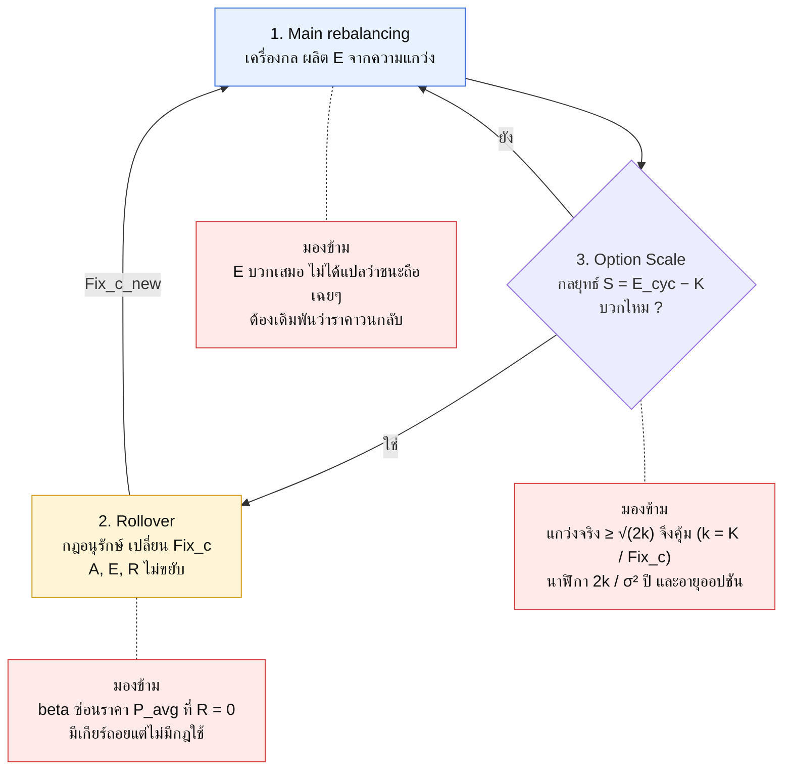
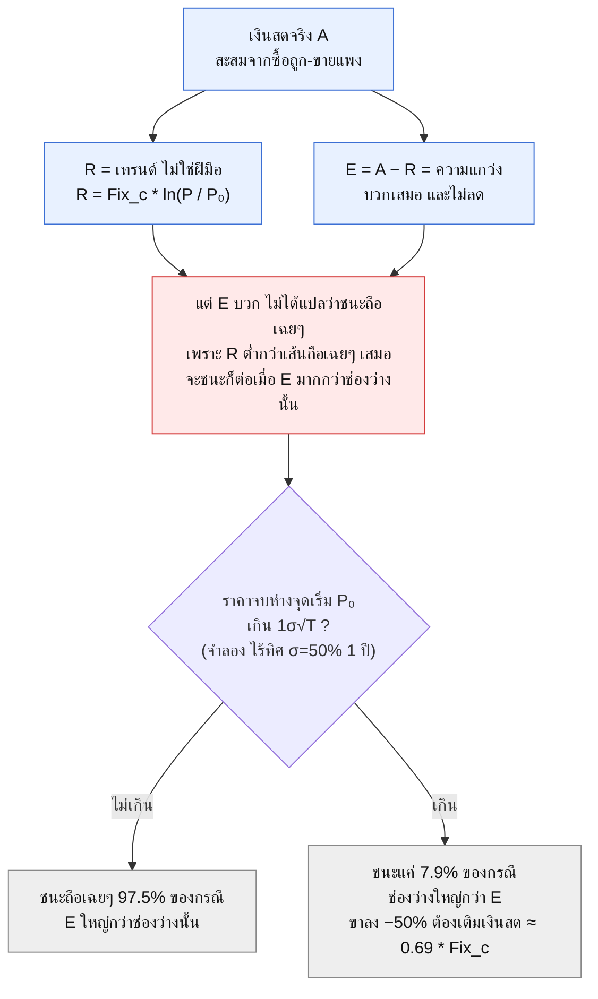
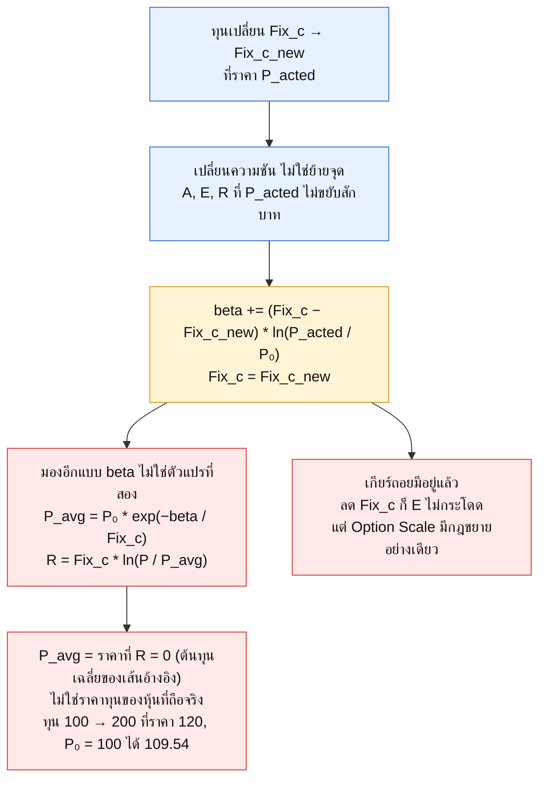
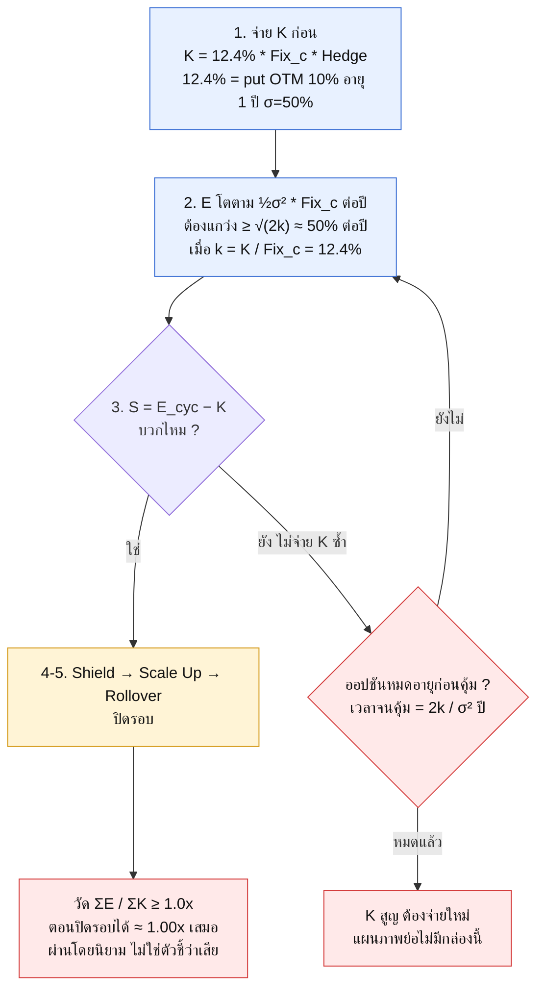

# Key Message — Main rebalancing · Rollover · Option Scale

**มุมที่ผู้เขียนหลักการมองข้าม** — สกัดจาก `cheat_sheet/*.mmd`, `test_cheat_sheet.py` และคู่มือ 101/Playground (`web_apps/`)
แล้วพิสูจน์ตัวเลขด้วยฟังก์ชัน ledger ของ repo (`lego_dash_core.py`) และการจำลอง (วิเคราะห์ ณ commit `f273f9c`)

## 🎯 จำให้ได้ (TL;DR)

สรุป 10 ข้อ + ประโยคเดียว อยู่ที่ [`cheat_sheet/summary.md`](../../cheat_sheet/summary.md)
และแสดงในแอปที่แท็บ ⚡ Cheat Sheet → 📝 Summary

> ข้อ 4, 9 และ 10 ของสรุปอิงการจำลอง GBM ที่ไม่มีค่าธรรมเนียม และเรื่องอายุออปชันรอผู้เขียนยืนยัน ดู "ข้อจำกัด" ท้ายเอกสาร

---

"มองข้าม" ในเอกสารนี้ = สิ่งที่ไม่พบในแผนภาพ เทสต์ หรือคู่มือของ repo นี้ และพิสูจน์ได้ด้วยตัวเลข (ยกเว้นข้อที่ติดป้าย ❓)

> เอกสารเชิงแนวคิดและคณิตศาสตร์ ไม่ใช่คำแนะนำการลงทุน

**ป้ายหลักฐาน** 🔎 ข้อความ/ตัวเลขของผู้เขียนเอง · 🧪 จำลองหรือตรวจเชิงตัวเลข (พารามิเตอร์ท้ายเอกสาร) · ❓ ข้อสันนิษฐาน ต้องให้ผู้เขียนยืนยัน

| ไฟล์ | คืออะไร |
|---|---|
| `key_overview.mmd` | สามกล่องเป็นวงเดียว พร้อมมุมที่มองข้ามของแต่ละกล่อง |
| `key_main_rebalancing.mmd` | E บวกเสมอ แต่ชนะถือเฉยๆ หรือไม่ |
| `key_rollover.mmd` | beta ซ่อนราคา `P_avg` (ที่ R = 0) และเกียร์ถอย |
| `key_option_scale.mmd` | เดิมพัน `σ ≥ √(2k)` และนาฬิกา `2k/σ²` ปี |

ซอร์สจริงคือไฟล์ `.mmd` (Mermaid มาตรฐาน ยังไม่ผูกกับแท็บ Cheat Sheet) ส่วนบล็อกในเอกสารนี้คัดลอกมาจากไฟล์เหล่านั้น
GitHub แสดง Mermaid ใน `.md` ได้เลย ที่อื่นให้วางเนื้อ `.mmd` ใน Mermaid Live Editor

## สัญลักษณ์

| สัญลักษณ์ | ความหมาย |
|---|---|
| `Fix_c` | มูลค่าหุ้นที่ถือคงที่ (USD) |
| `P`, `P₀`, `P_acted` | ราคาปัจจุบัน, ราคาอ้างอิงตั้งต้น (ตรึง), ราคา ACT ล่าสุด |
| `A`, `R`, `E` | เงินสดสะสมจริง, เส้นอ้างอิง `Fix_c·ln(P/P₀)`, ส่วนเกิน `A − R` |
| `X` | `P / P₀` |
| `φ(X)` | `Fix_c·[(X − 1) − ln X] ≥ 0` คือช่องว่างระหว่างเส้นถือเฉยๆ กับ R |
| `K`, `k` | ต้นทุนออปชันที่จ่ายก่อน (USD), `k = K / Fix_c` (เมื่อ Hedge = 1) |
| `σ`, `T`, `μ` | ความผันผวนต่อปี, เวลา (ปี), อัตราเติบโตเฉลี่ยของราคาต่อปี (`E[P_T/P₀] = e^{μT}`) |
| `P_avg` | ราคาที่ R = 0 `= P₀·e^(−beta/Fix_c)` คือต้นทุนเฉลี่ย (log) ของเส้นอ้างอิง ไม่ใช่ราคาทุนของหุ้นที่ถือจริง |

ถือเฉยๆ = ถือหุ้น `Fix_c/P₀` ตัวนิ่งๆ ไม่ทำอะไร (buy & hold) กำไร `= Fix_c·(X − 1)`

## 🧭 ภาพรวมรายหัวข้อ

| # | Key message (รู้ทันทีว่าคืออะไร) | มุมที่ผู้เขียนมองข้าม |
|---|---|---|
| 1 Main rebalancing | เงินสดจริง **A = เทรนด์ R + ความแกว่ง E** ดูที่ E | E บวกเสมอเพราะ "ไม้บรรทัด" R ต่ำกว่าเส้นถือเฉยๆ ไม่ใช่เพราะตลาดให้ ต้องเดิมพันว่าราคา "วนกลับ" |
| 2 Rollover | เปลี่ยน **ความชัน** (ขนาดทุน) ไม่ใช่ย้ายจุด A, E, R ที่ pivot ไม่ขยับ | beta ไม่ใช่ตัวแปรที่สอง แต่ซ่อน **ราคา `P_avg` ที่ R = 0** (ไม่ใช่ราคาทุนหุ้นจริง) และมีเกียร์ถอยที่ไม่มีกฎใช้ |
| 3 Option Scale | จ่าย K ก่อน รอให้ E เกิน K แล้วขยายทุนด้วยส่วนเกิน S | เดิมพันว่า **แกว่งจริง ≥ √(2k)** และมี **นาฬิกา 2k/σ² ปี** ที่ไม่อยู่ในแผนภาพ |

สามกล่องไม่ใช่ของชนิดเดียวกัน: (1) เครื่องกล (2) กฎอนุรักษ์ (3) กลยุทธ์ มีเฉพาะกล่อง 3 ที่มีสมมติฐานที่พิสูจน์ผิดได้

---

## 1. Main rebalancing — เครื่องผลิต E

**คิดง่ายๆ:** ร้านที่ตั้งกฎ "สต็อกต้องมีมูลค่า 1,500 เสมอ" ของแพงขึ้นก็ขายส่วนเกิน ของถูกลงก็ซื้อเติม

**ผู้เขียนเห็นแล้ว** 🔎 `A = R + E` · `E ≥ 0` และไม่ลด (`lego_dash_core.py:1142`, คู่มือ 101 บทที่ 2) · ราคาวิ่งทางเดียวได้ `E ≈ 0`

### 🕳️ มองข้าม: E บวกเสมอเพราะ "ไม้บรรทัด" ไม่ใช่เพราะตลาดให้

**① R ไม่ใช่เส้นถือเฉยๆ** 🧪

`ถือเฉยๆ − R = Fix_c·[(X − 1) − ln X] = φ(X) ≥ 0` (จาก `x − 1 ≥ ln x` และเท่ากับ 0 เมื่อ X = 1 เท่านั้น)

| X | R | ถือเฉยๆ | ช่องว่าง φ(X) |
|---|---|---|---|
| 0.5 | −1,039.72 | −750.00 | 289.72 |
| 0.8 | −334.72 | −300.00 | 34.72 |
| 1.1 | 142.97 | 150.00 | 7.03 |
| 1.5 | 608.20 | 750.00 | 141.80 |
| 2.0 | 1,039.72 | 1,500.00 | 460.28 |

(Fix_c = 1,500) จึงได้ `A − ถือเฉยๆ = E − φ(X)` และเมื่อสะสมหลายก้าว `A − ถือเฉยๆ = Σφ(แต่ละก้าว) − φ(ก้าวสุทธิ)` ตรวจกับ ledger ของ repo บน 2,000 เส้นทางสุ่ม คลาดไม่เกิน ~2e-12

**② ตัวอย่างของผู้เขียนเอง** 🔎

- Option Scale (P₀ = 10, Fix_c = 1,500) ที่ P = 15: `E = 141.80` แต่ `A = ถือเฉยๆ = 750.00` ชนะถือเฉยๆ **0.00**
- ขึ้นทางเดียว +10% สามก้าว (100 → 133.1): `E = +21.10` แต่ `A = 450.00` ต่ำกว่าถือเฉยๆ `496.50`
- ลงทางเดียว −20% สามก้าว (100 → 51.2) 🧪: `E = +104.15` แต่ `A = −900.00` ต่ำกว่าถือเฉยๆ `−732.00` (ต้องเติมเงินสด 900 = 0.60 × Fix_c) ขาลงต่อเนื่องก็แพ้เช่นกัน
- คู่มือ 101 บทที่ 4 เขียนว่าการขายขาเดียว "ผลรวมเท่ากับถือเฉย ๆ (buy & hold) เป๊ะ" ซึ่งจริงเฉพาะก้าวแรก ก้าวที่สอง (110 → 121) ล้าหลังแล้ว 15.00

**③ ตลาดไร้ทิศ: E เฉลี่ยบวก แต่ส่วนต่างจากถือเฉยๆ เฉลี่ย ≈ 0** 🧪

(σ = 50%, 1 ปี, DIFF = 4% ของ Fix_c, 20,000 เส้นทาง ค่าเป็น % ของ Fix_c)

| ทิศของตลาด μ/ปี | E เฉลี่ย | A − ถือเฉยๆ เฉลี่ย | ชนะถือเฉยๆ | เปอร์เซ็นไทล์ 5 / 95 |
|---|---|---|---|---|
| 0% | +12.5% | 0.0% | 68% | −34% / +13% |
| +30% | +12.5% | −5.1% | 64% | −59% / +13% |
| +60% | +12.5% | −22.7% | 47% | −125% / +13% |
| −30% | +12.5% | −3.9% | 56% | −42% / +13% |

E เฉลี่ยเท่ากันทุกแถว (`≈ ½σ²T`) แต่ส่วนต่างจากถือเฉยๆ ตกตามทิศ สอดคล้องกับ `E[A − ถือเฉยๆ] = −Fix_c·(e^{μT} − 1 − μT)`
เมื่อไร้ทิศ ชนะ 68% ของเส้นทางแต่ชนะน้อย (เปอร์เซ็นไทล์ 95 = +13%) ส่วนอีก 32% แพ้และแพ้หนักกว่า (เปอร์เซ็นไทล์ 5 = −34%)

**④ กฎจำ** 🧪 ในการจำลองไร้ทิศ σ = 50% (แถวแรกของตารางข้างบน) เส้นทาง 67% จบห่างจุดเริ่มไม่เกิน `1σ√T` (`|ln X| ≤ σ√T`) และ Demon ชนะถือเฉยๆ ใน 97.5% ของกลุ่มนี้ ส่วนอีก 33% ที่จบไกลกว่านั้น ชนะแค่ 7.9%

**⑤ Fix_c ไม่ใช่ทุนทั้งหมด** 🧪 ขาลงต้องเติมเงินสดสะสม `≈ Fix_c·ln(P₀/P) − E`

| ราคาลง | −30% | −50% | −70% | −90% |
|---|---|---|---|---|
| เงินสดที่ต้องเติม | 0.36 × Fix_c | 0.69 × Fix_c | 1.19 × Fix_c | 2.24 × Fix_c |

ไม่พบเรื่องนี้ในเอกสารของ repo (Option Scale ข้อ 5.1 พูดถึงสภาพคล่องเฉพาะการจ่าย K)

> [!NOTE]
> **หลักการที่ซ่อน:** `E ≥ 0` เป็นสมบัติของ "ไม้บรรทัด" ไม่ใช่ของตลาด E เท่ากันทุกทิศ (+12.5%) แต่ผลต่างจากถือเฉยๆ ขึ้นกับทิศทั้งหมด Demon ไม่ต้องรู้ทิศ แต่ต้องเดิมพันว่าราคาไม่เดินทางเดียว

**❓ ถามก่อนเชื่อกล่องนี้:** E ที่บวกอยู่มากกว่า `φ(X)` หรือยัง? เงินสดสำรองขาลงที่ยอมรับได้คือเท่าไร?

---

## 2. Rollover — เปลี่ยนความชัน ไม่ใช่ย้ายจุด

**คิดง่ายๆ:** ซื้อหุ้นเพิ่มแล้ว "ต้นทุนเฉลี่ย" ขยับ Rollover ขยับ "จุดเริ่มนับ" ของเส้นอ้างอิงแบบเดียวกัน เงินก้อนใหม่จะได้ไม่ถูกนับว่าอยู่มาตั้งแต่ P₀

**ผู้เขียนเห็นแล้ว** 🔎 หมุนเส้นรอบจุด ไม่กระโดด (Playground) · pivot ต้องเป็น `P_acted` ไม่ใช่ราคาสด (`test_cheat_sheet.py:311` ใช้ราคาสดแล้วได้กำไรปลอม ≈ +142.97) · beta บวกที่ R ไม่ใช่ A (`:288`) · เท่ากับเปิด chain ใหม่ที่ `P_acted` (`:266`)

### 🕳️ มองข้าม

**① beta ไม่ใช่ตัวแปรที่สอง คือต้นทุนเฉลี่ยที่ซ่อนอยู่** 🔎🧪 (ตัวอย่างเป็นของผู้เขียน สมการและการตรวจเป็นของเอกสารนี้)

หลัง rollover `R = R(pivot) + Fix_c_new·ln(P / P_acted) = Fix_c_new·ln(P / P_avg)` เมื่อ `P_avg = P₀·e^(−beta / Fix_c_new)`

P_avg คือราคาที่เส้นอ้างอิงตัดศูนย์ (`R = 0`) และเท่ากับค่าเฉลี่ยเรขาคณิตของราคาที่เงินแต่ละก้อนเข้ามา ถ่วงด้วยขนาดเงิน (เงินที่ถอนออกมีน้ำหนักลบ)
มันเป็นสมอของเส้น R ไม่ใช่ราคาทุนของหุ้นที่ถืออยู่จริง (ราคาทุนจริงขึ้นกับราคาที่ซื้อขายจริง)

- Playground (ทุน 100 → 200 ที่ราคา 120, P₀ = 100): `beta = (100 − 200)·ln 1.2 = −18.23` แล้ว `P_avg = 100·e^(18.23/200) = 109.54 = √(100 × 120)`
- เทสต์ `:322` (ทุน 1,500 → 2,200 ที่ 112 → 900 ที่ 95 → 1,500 ที่ 130, P₀ = 100): `P_avg = 122.4199` ทั้งสองวิธี
- R ที่ราคา 90 / 120 / 150 ของตัวอย่าง Playground ได้ −39.30 / 18.23 / 62.86 เท่ากันทั้งสามรูป (beta, แยกที่ pivot, `ln(P/P_avg)`) และ `R(P_avg)` ของทั้งสองตัวอย่างข้างบนเป็นศูนย์ (คลาด ~1e-14)
- ลดทุน 1,500 → 500 ที่ราคา 130 (P₀ = 100): `P_avg = 59.17` ต่ำกว่าราคาที่เงินก้อนไหนเคยเข้า (100 และ 130) เพราะเงินที่ถอนมีน้ำหนักลบ จึงเห็นชัดว่า P_avg เป็นสมอของเส้น R ไม่ใช่ราคาทุน

ผล: (Fix_c, beta, P₀) สามตัวเหลือ (Fix_c, P_avg) สองตัว และสูตร R กลับเป็นรูปเดียวกับ Main

**② เกียร์ถอยมีอยู่แล้ว แต่ไม่มีกฎใช้** 🧪 ลด Fix_c ก็ E ไม่กระโดด (สุ่ม 2,000 รอบ ผสมเพิ่ม/ลดทุน คลาดไม่เกิน ~5e-13) แต่ Option Scale มี `Fix_c_new = Fix_c + S` โดย S บวกเท่านั้น ไม่มีเส้นทางลดทุน

**③ ❓ ไม่มีกล่อง "สั่งซื้อ"** ทุนใหม่ถูกซื้อผ่าน `Gap = Q·P − Fix_c_new` ในรอบ Main ถัดไป ซึ่ง `Gap ≈ −S` ถ้า `S ≤ DIFF` ก็ PASS (ยังไม่ซื้อ) จนกว่าราคาจะขยับ ขณะที่บัญชีนับว่า Fix_c_new มีผลแล้ว (ตัวอย่างผู้เขียน S = 64.06 เทียบ DIFF = 60 ค่าตัวอย่างในคู่มือ 101 เกินแค่เฉียด)

> [!NOTE]
> **หลักการที่ซ่อน:** Conservation แก้ได้เฉพาะอนาคต (ความชัน) ประวัติ ณ pivot ต้องไม่ขยับ และ (Fix_c, beta, P₀) ≡ (Fix_c, P_avg)

**❓ ถามก่อนเชื่อกล่องนี้:** ทุนใหม่เข้าที่ราคาไหนจริง? S มากกว่า DIFF หรือไม่? ต้องมีเกียร์ถอยเมื่อไร?

---

## 3. Option Scale — จ่าย K ก่อน แล้วให้ความแกว่งผ่อนชำระ

**คิดง่ายๆ:** ร้านจ่ายค่าเช่าล่วงหน้า (K) กำไรร้าน (E) เกินค่าเช่าเมื่อไหร่ ส่วนเกิน (S) ค่อยไปเปิดสาขา ถ้ายังไม่เกินก็รอต่อโดยไม่จ่ายเช่าซ้ำ **แต่สัญญาเช่ามีวันหมดอายุ**

**ผู้เขียนเห็นแล้ว** 🔎 ลำดับ 1 → 5.2 ถูกล็อกด้วยเทสต์ (`test_cheat_sheet.py:115`) · "ไม่จ่าย K ซ้ำ" · "Zero-Cost ≠ ไม่เสี่ยง" · 12.4% สร้างใหม่ได้จาก Black-Scholes (`:337`) · ตัวเลข app-v4 ทำซ้ำได้ (`:346`)

### 🕳️ มองข้าม

**① แกว่งจริงต้อง ≥ √(2k)** เมื่อ `k = K / Fix_c`

- E โตตาม `½σ²·Fix_c` ต่อปี 🧪 (ตลาดไร้ทิศ, จำลอง 5 นาที, DIFF = 4%) σ = 30 / 50 / 80% ได้ 4.47 / 12.50 / 32.3% ของ Fix_c (ทฤษฎี 4.5 / 12.5 / 32.0%)
- 12.4% ในกล่อง 🔎 คือเบี้ย put OTM 10% อายุ 1 ปี σ = 50% r = 4% ซึ่ง `½σ² = 12.5%` พอดี
- จึงต้องแกว่ง `σ ≥ √(2k) = √(2 × 12.4%) ≈ 50%` ต่อปี จึงคุ้มภายใน 1 ปี

**② นาฬิกา `2k/σ²` ปี** 🧪

| σ จริง/ปี | E ต่อปี (½σ²) | E/K เมื่อ k = 12.4% | เวลาจน E เกิน K (จำลอง) | `2k/σ²` |
|---|---|---|---|---|
| 30% | 4.5% | 0.36x | 2.79 ปี | 2.75 |
| 40% | 8.0% | 0.65x | 1.55 ปี | 1.55 |
| 50% | 12.5% | 1.01x | 1.00 ปี | 0.99 |
| 80% | 32.0% | 2.58x | 0.39 ปี | 0.39 |

เปอร์เซ็นไทล์ 90 อยู่ใกล้มัธยฐานภายใน ~10% จึงทำนายเวลาได้เกือบแน่
`S = E_cyc − K` ไม่มีวันลด (E ไม่ลด, K คงที่) วง 3 → 3.1 → 2 จึงปิดได้ ถ้าราคายังแกว่งต่อ (ตลาดนิ่งสนิท E ก็ไม่โต) และออปชันยังไม่หมดอายุ คำถามจริงคือ "นานแค่ไหนเทียบอายุของสิ่งที่ K ซื้อ"
แผนภาพย่อไม่มีอายุหรือการ roll ออปชัน ❓ (แผนผังเต็ม `app_v4_system.mmd` ใน repo super_app อาจมีอยู่แล้ว)
🧪 แม้ reprice K ตาม σ ของหุ้นนั้น (put OTM 10% อายุ 1 ปี) จุดคุ้มทุนก็ยังอยู่ที่ σ ≈ 49% ต่ำกว่านั้น E ต่อปีได้เพียง 0.78–0.91 เท่าของเบี้ยที่ยุติธรรม (σ 15–40%)

**③ "ΣE/ΣK ≥ 1.0x" ผ่านเสมอตอนปิดรอบ** 🧪 รอบปิดได้ก็ต่อเมื่อ `S > 0` ซึ่งคือ `E/K > 1` ตามนิยาม จำลองได้ 1.000–1.011x ตอนปิด ไม่ใช่ 1.34x ของตัวอย่างผู้เขียน ซึ่งมาจากก้าวเดียว (E กระโดด 141.80 → 250.00 เมื่อราคา 15 → 10) ตัวที่ล้มเหลวได้จริงคืออายุของรอบที่ยังเปิดค้าง

**④ Scale Up ขยายผล ไม่ขยายความได้เปรียบ** 🔎 `K / Fix_c = 12.396%` ทั้งก่อนและหลัง (K 185.94 → 193.88 เมื่อ Fix_c 1,500 → 1,564.06) อัตราส่วน E/K ไม่ขึ้นกับขนาดทุน ขึ้นกับ σ เท่านั้น

**⑤ ❓ R ที่ "เก็บเข้ากระเป๋า" เป็นหนี้รอคืน** 🔎 ตัวอย่างผู้เขียน: ที่ P = 15 `A = 750.00` (R = 608.20 + E = 141.80) แล้วที่ P = 10 `R = 0` เงินสดเหลือ 250.00 = E ถ้า Pool CF ถูกถอนไปใช้ รอบซื้อกลับ 500 จะขาด 358.20 (ถ้า Pool CF คือเงินกันไว้ซื้อกลับ ข้อนี้ไม่เป็นปัญหา)

> [!NOTE]
> **หลักการที่ซ่อน:** Payback clock ต้นทุนคงที่ (k) ÷ รายได้ต่อปี (½σ²) = ปีที่ใช้คืนทุน Option Scale ชนะเมื่อหุ้นแกว่งมากกว่าที่ราคาออปชันคิดไว้ ไม่ใช่เมื่อทุนโต

**❓ ถามก่อนเชื่อกล่องนี้:** σ จริงของหุ้นตัวนี้เท่าไร เทียบ √(2k)? รอบที่เปิดค้างอยู่นานกว่าอายุออปชันที่ K ซื้อหรือยัง?

---

## 🏆 สรุปหลักการ

| # | หลักการ | อธิบายง่ายๆ | มุมที่ผู้เขียนมองข้าม |
|---|---|---|---|
| 1 | Separation | A = R + E แยกทิศออกจากความแกว่ง | ไม้บรรทัด R เตี้ยกว่าถือเฉยๆ จึง E ≥ 0 เสมอ ไม่ได้แปลว่าชนะถือเฉยๆ |
| 2 | Conservation | เปลี่ยนความชัน ไม่ย้ายจุด | beta ซ่อนราคา `P_avg` ที่ R = 0 (ไม่ใช่ราคาทุนหุ้นจริง) และมีเกียร์ถอยที่ไม่มีกฎใช้ |
| 3 | Payback clock | ค่าเช่า ÷ กำไรต่อปี | ต้อง `σ ≥ √(2k)` เวลาคุ้ม `2k/σ²` ปี และ ΣE/ΣK ≥ 1 ผ่านโดยนิยาม |

## ⚠️ ข้อจำกัด และสิ่งที่ต้องยืนยัน

- การจำลองใช้ราคาแบบ GBM (σ คงที่) ไม่มีค่าธรรมเนียม/สเปรด และ ledger คิดจากราคาหุ้นอย่างเดียว ไม่รวม theta/IV ของ LEAPS (หุ้น 20% + LEAPS 80%) ตลาดจริงที่มีหางหนา ความผันผวนเป็นกลุ่ม หรือการวนกลับ/แนวโน้ม จะเปลี่ยนตัวเลข แต่ไม่เปลี่ยนโครงสร้างของข้อสังเกต
- `cheat_sheet/option_scale.mmd` เป็นฉบับย่อของ `app_v4_system.mmd` (repo super_app ซึ่งผู้เขียนเอกสารนี้เข้าไม่ถึง) ข้อ "นาฬิกา" อาจเป็นสิ่งที่ถูกตัดตอนย่อ
- ❓ K ซื้ออะไรกันแน่: กล่อง 1 ระบุ Deep ITM LEAPS แต่เลข 12.4% ในเทสต์คิดจาก put OTM 10% สิ่งที่ K ซื้อและอายุของมันกำหนดว่า "นาฬิกา" เดินเร็วแค่ไหน
- ❓ ความหมายของ "Pool CF" (Option Scale ข้อ ⑤) ตีความจากแผนภาพ ไม่ใช่จากนิยามที่ผู้เขียนเขียนไว้
- `beta` มีในเอกสารและเทสต์ ส่วน `lego_dash_core.py` ใช้วิธีเปิด chain ใหม่ (เทสต์พิสูจน์ว่าให้ผลเท่ากัน)
- คำว่า "ไม่พบ" หมายถึงค้นใน `cheat_sheet/`, `web_apps/`, `docs/`, `README.md`, `streamlit_app.py`, `lego_dash_core.py` แล้วไม่เจอ

## 📎 ภาคผนวก — วิธีตรวจซ้ำตัวเลข

**สมการ**

- ต่อก้าว `ΔE = Fix_c·[(x − 1) − ln x] ≥ 0` เมื่อ `x = P/P_acted` ดังนั้น `E = ΣΔE` (ตรงกับ `gated_rebalancing_cashflow_from_prices`)
- `A − ถือเฉยๆ = Σφ(ก้าว) − φ(ก้าวสุทธิ)` เมื่อ `φ(x) = Fix_c·[(x − 1) − ln x]`
- GBM: `E[E] = ½σ²T·Fix_c` (Itô: `∫dP/P − ln(P/P₀) = ½σ²T`) และ `E[A − ถือเฉยๆ] = −Fix_c·(e^{μT} − 1 − μT)`
- เงินสดขาลง `≈ Fix_c·ln(P₀/P) − E`
- Rollover: `beta = Σ (Fix_cₖ − Fix_cₖ₊₁)·ln(P_actedₖ / P₀)` และ `P_avg = P₀·e^(−beta/Fix_c)`
- Option Scale: เวลาคุ้ม `t = k / (½σ²) = 2k/σ²` และ `σ* = √(2k/T)`

**พารามิเตอร์จำลอง** (numpy, seed คงที่ สคริปต์ยังไม่ได้เก็บใน repo)

- Main / ถือเฉยๆ: GBM, 1 ปี, bar 30 นาที (252 × 13 ต่อปี), DIFF/Fix_c = 4% (60/1,500 จากคู่มือ 101), 20,000 เส้นทาง, seed 11, A วัดแบบ mark-to-market (เงินสด + ส่วนที่ราคาเดินจาก act ล่าสุด)
- นาฬิกา / Option Scale: GBM ไม่มีดริฟต์, bar 5 นาที (252 × 78 ต่อปี), DIFF 4%, 300–400 เส้นทาง, seed 2026
- ตัวอย่างของผู้เขียน: เรียก `lego_dash_core.gated_rebalancing_cashflow_from_prices` และ Black-Scholes แบบเดียวกับ `_premium_rate` (`test_cheat_sheet.py:337`)
